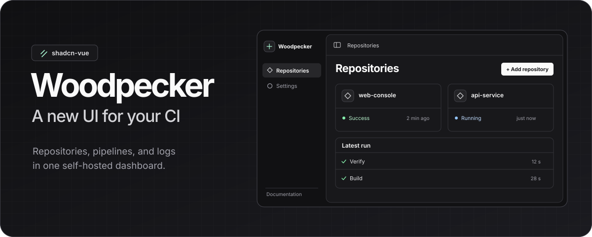

# Woodpecker CI · shadcn-vue

A community fork of [Woodpecker CI](https://github.com/woodpecker-ci/woodpecker) with a refreshed Vue dashboard built around [shadcn-vue](https://www.shadcn-vue.com/).

<p align="center">
  
</p>

[Browse the dashboard source](https://github.com/shawniwe/woodpecker/tree/experiment/shadcn-self-deploy/web) · [View the self-deploy workflow](https://github.com/shawniwe/woodpecker/blob/experiment/shadcn-self-deploy/.woodpecker/self-deploy-ui.yaml) · [Report an issue](https://github.com/shawniwe/woodpecker/issues)

## The dashboard

- **Collapsible navigation** for repositories, administration, documentation, and account settings.
- **Repository cards** with the latest pipeline status, run time, and commit message.
- **Pipeline details** with individual job states, durations, and a log panel that names the selected job.
- **Light and dark themes** shared across navigation, forms, and settings.

The preview uses sample repositories. The fork runs the redesigned frontend against the Woodpecker CI backend.

## Build the frontend

The dashboard branch is based on **Woodpecker v3.20.1**. To build it locally with Node.js 24 or later:

```bash
git clone --branch experiment/shadcn-self-deploy https://github.com/shawniwe/woodpecker.git
cd woodpecker/web
npm exec --yes --package=pnpm@12.18.0 -- pnpm install --frozen-lockfile
npm exec --yes --package=pnpm@12.18.0 -- pnpm build
```

For an interactive development setup with the CI server, follow the [upstream development guide](https://woodpecker-ci.org/docs/development/getting-started). This fork is an experiment distributed as source.

## How the fork deploys itself

Woodpecker checks types, runs frontend tests, and builds its own dashboard. A service on the VPS receives the build, publishes it through nginx, and verifies the new UI over HTTPS. If verification fails, the service restores the previous build. The [publication scripts](https://github.com/shawniwe/woodpecker/tree/experiment/shadcn-self-deploy/contrib/self-deploy-ui) document this fork’s VPS setup.

## Credits and license

Built on [Woodpecker CI](https://github.com/woodpecker-ci/woodpecker) with [shadcn-vue](https://www.shadcn-vue.com/), Vue, and Tailwind CSS. The Woodpecker codebase is licensed under [Apache 2.0](LICENSE). Upstream documentation in `docs/` is licensed under [CC BY-SA 4.0](https://creativecommons.org/licenses/by-sa/4.0/).
